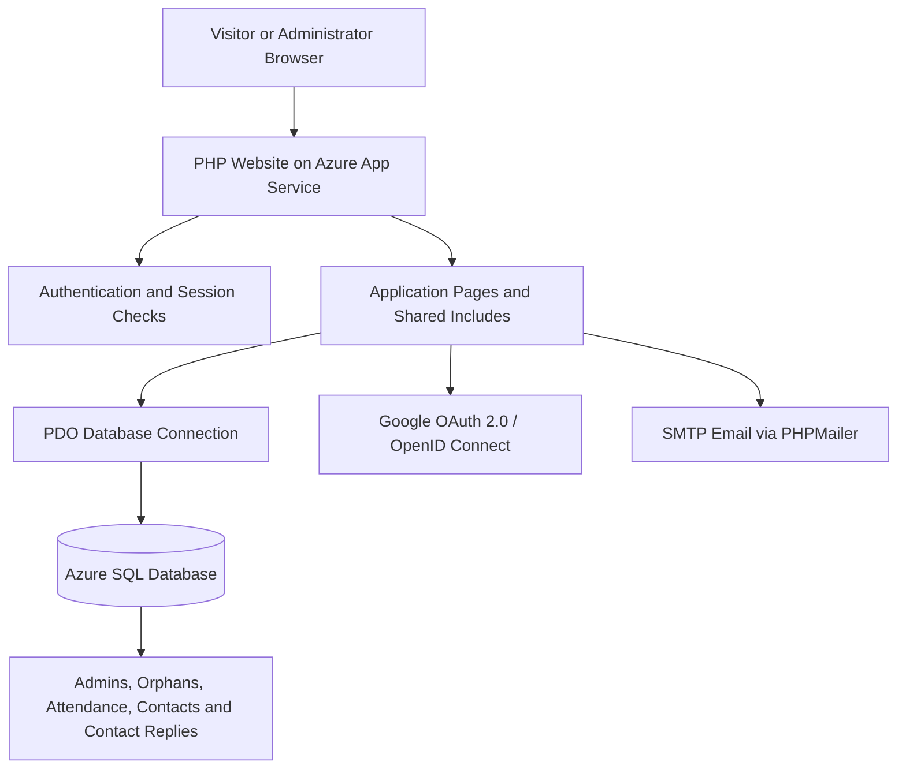

<div align="center">


# Abba House Management System

**A responsive web-based administration system for managing beneficiary records, attendance and visitor enquiries at Abba House.**

</div>

---

## 1. Project Overview

The Abba House Management System is a PHP-based web application designed to support the day-to-day administrative activities of an orphanage. It provides a public-facing website and a protected administration area where authorised administrators can manage registered children, record attendance and respond to enquiries submitted through the website.

The project began as a locally hosted PHP and MariaDB application developed and tested with XAMPP. It was subsequently adapted for cloud hosting using **Azure App Service** and **Azure SQL Database**. The application also supports Google Single Sign-On (SSO) for administrator authentication.

The system aims to reduce reliance on paper-based administration, keep information organised in a central database and make key administrative functions accessible through desktop and mobile-sized screens.

## 2. Purpose and Objectives

The main purpose of the application is to provide Abba House with a centralised system for its public information and selected administrative processes.

The project objectives are to:

- Provide a public website where visitors can learn about Abba House and submit enquiries.
- Allow authorised administrators to access a protected dashboard.
- Store and manage children’s registration information and supporting documents.
- Record daily attendance and view attendance information.
- Keep visitor enquiries available to administrators and support email replies.
- Provide an alternative administrator sign-in method through Google SSO.
- Support both local development and cloud hosting.
- Use automated pipeline checks to identify PHP syntax errors when code changes are pushed.

## 3. Application Features

### Public website

- Public homepage presenting information about Abba House.
- Contact page containing the enquiry form and organisation contact/location information.
- A map link that allows visitors to view the organisation's location.
- Responsive layouts intended to work across desktop and mobile screen sizes.

### Administrator authentication and dashboard

- Administrator sign-in using the existing email-and-password form.
- Google Single Sign-On using OAuth 2.0 / OpenID Connect.
- Google sign-in is restricted to an email address that already exists in the administrator (`admins`) table. Signing in with an unapproved Google account does not automatically create an administrator.
- Session-based access control for protected administration pages.
- Dashboard displaying management statistics and attendance controls.
- Logout action with a confirmation interface.

### Beneficiary (orphan) management

- Registration form for a child's details.
- Upload fields for a child's photograph and birth certificate.
- Orphan records list with status filtering and record actions.
- Individual orphan details page.
- Record statuses include **Active**, **Adopted** and **Deregistered**.
- Adoption and deregistration update the record status rather than immediately removing the record.
- Permanent deletion is restricted to deregistered records. The deletion operation also removes associated attendance rows and attempts to remove the associated uploaded documents.

### Attendance management

- Administrators can mark a registered child's attendance as Present or Absent.
- Attendance is stored against the child and attendance date.
- The dashboard displays attendance information for the current day.

### Visitor enquiries and replies

- Visitors can submit an enquiry through the public contact form.
- Administrators can view submitted enquiries in the Visitor Messages area.
- A message can be opened to view its full details.
- Administrators can compose and send a reply to the visitor's saved email address through SMTP.
- Reply records and delivery status are stored in the `contact_replies` table in the deployed database.

## 4. Design Considerations

The application was designed around the needs of two main user groups:

1. **Website visitors**, who need a straightforward way to learn about Abba House and submit an enquiry.
2. **Administrators**, who need protected access to registration, attendance and message-management functions.

The main design considerations were:

- **Usability:** navigation and forms are organised around common visitor and administrator tasks.
- **Responsive layout:** the interface adapts to desktop and smaller mobile screens.
- **Separation of access:** public pages are available to visitors, while management pages require an administrator session.
- **Data organisation:** registration, attendance, administrator and enquiry information is stored in relational database tables.
- **Record lifecycle:** adopted and deregistered records can be retained for reference; permanent deletion is a separate action for deregistered records.
- **Configuration:** database and Google OAuth settings for the Azure deployment are supplied through application environment variables rather than being embedded in the source code.
- **Maintainability:** common database, authentication, header, footer and mail functionality is organised into shared PHP files.

## 5. Technologies and Tools

| Technology / tool | Role in the project |
|---|---|
| PHP | Server-side application logic, form processing, authentication and database operations. |
| HTML | Page structure and form elements. |
| CSS | Page styling and responsive layouts. |
| JavaScript | Client-side interface interactions. |
| MariaDB / MySQL | Local development database used with XAMPP. |
| Azure SQL Database | Cloud database used by the deployed application. |
| PDO | PHP database access layer and prepared database statements. |
| Google OAuth 2.0 / OpenID Connect | Google administrator sign-in and identity verification. |
| PHPMailer | SMTP email delivery for administrator replies to visitor enquiries. |
| XAMPP | Local Apache, PHP and MariaDB development environment. |
| Git and GitHub | Source control and project repository. |
| GitHub Actions | Automated PHP syntax validation on pushes and pull requests. |
| Azure Pipelines | A separate pipeline for PHP syntax validation. |
| Azure App Service | Hosting environment for the PHP website. |
| Azure environment variables | Runtime configuration for the cloud database and Google SSO credentials. |

## 6. System Architecture

The application follows a server-rendered PHP architecture. A visitor or administrator accesses the website through a browser. PHP processes the request on the web server, uses PDO to communicate with the configured database, and returns the resulting page to the browser.



### Database connection modes

The shared database connection file, `includes/db.php`, selects the database connection according to the `DB_CONNECTION` environment variable:

- When `DB_CONNECTION` is set to `sqlsrv`, the application connects to Azure SQL Server using the SQL Server PDO driver and the configured server, database, username and password.
- Otherwise, the local development configuration connects to the `abba_house_db` MySQL/MariaDB database on `localhost`.

This allows the application to use different database environments without maintaining separate application page code for each environment.

## 7. Database Design

The application uses relational tables to keep its information organised.

| Table | Purpose |
|---|---|
| `admins` | Stores administrator account details used by the sign-in and authorisation process. |
| `orphans` | Stores registered children's details, status and uploaded document paths. |
| `attendance` | Stores attendance status by child and date. |
| `contacts` | Stores enquiries submitted through the public contact form. |
| `contact_replies` | Stores administrator replies, delivery status and related reply information in the deployed application. |

The `orphans` table is related to `admins` through the administrator who registered the record. The `attendance` table is related to `orphans` through `orphan_id`. The deployed application also uses `contact_replies` to keep a history of replies associated with visitor enquiries.

**Database setup note:** `database/abba_house.sql` is the original local MySQL/MariaDB starter schema. It provides the initial database and core tables and sample data; it should not be assumed to be a complete export of every later Azure database change. In particular, the deployed application also uses the `contact_replies` table and orphan record status values. Use the current database schema/migrations for a complete restoration of the deployed version rather than importing the starter SQL file and assuming it contains every later change.

## 8. Google Single Sign-On (SSO)

Google SSO was implemented using Google's OAuth 2.0 authorization-code flow and OpenID Connect identity information.

The sign-in process works as follows:

1. The administrator selects **Continue with Google** on the sign-in page.
2. `auth/google_login.php` creates a random `state` value, stores it in the PHP session and redirects the browser to Google's authorization endpoint.
3. Google authenticates the user and redirects back to `auth/google_callback.php`.
4. The callback checks the returned `state` value and its age, then exchanges the one-time authorization code for an access token.
5. The application requests the user's identity information from Google's OpenID Connect user-info endpoint.
6. The application checks that the email is verified and looks for a matching email in the existing `admins` table.
7. Only an approved administrator is given an application session and redirected to the dashboard. An unapproved Google account is denied access.

The OAuth client ID, client secret and redirect URI are supplied through environment variables. They must not be committed to the public repository.

The configured production callback URL is:

`https://abbaproject-e6hvfdabfeahgtcn.southafricanorth-01.azurewebsites.net/auth/google_callback.php`

The Google OAuth configuration must use the matching authorised web origin and redirect URI.

## 9. GitHub Actions and Azure Pipelines

The repository contains two YAML workflow definitions. Both perform PHP syntax validation, but they belong to separate automation services.

### GitHub Actions — `.github/workflows/php-tests.yaml`

The GitHub Actions workflow is named **PHP Automated Tests**.

- `push` with the `**` branch pattern triggers the workflow for pushes to branches of any name.
- `pull_request` targeting `main` also triggers the workflow.
- `permissions: contents: read` gives the workflow read-only repository content permission.
- `actions/checkout@v4` checks out the repository onto the runner.
- `shivammathur/setup-php@v2` installs PHP 8.2 for the validation job.
- The workflow prints the PHP version and runs `php -l` against discovered PHP files.
- The file search skips `.git`, `.github` and `vendor` directories.
- `set -e` makes the script stop when a command fails, so a syntax error causes the job to fail rather than report a successful validation.

### Azure Pipelines — `azure-pipelines.yaml`

The Azure Pipelines YAML defines a separate pipeline.

- The `trigger` section includes pushes to branches matching `*`.
- `pool: vmImage: ubuntu-latest` requests a Microsoft-hosted Ubuntu agent.
- `checkout: self` checks out the repository.
- One step prints the available PHP version.
- A Bash step searches for PHP files and runs `php -l` on each one, skipping `.git`, `.github` and `vendor`.

### What these workflows do — and do not do

Both workflows are intended to catch PHP **syntax errors** early in the development process. PHP's `-l` option checks whether a file can be parsed; it does not execute the website or test its behaviour.

These workflows do **not** constitute full functional or browser testing. They do not, by themselves, verify Google SSO, database connectivity, form submissions, email delivery or attendance behaviour. The YAML files in this repository also do **not** contain Azure App Service deployment steps. A deployment carried out separately through Azure or a ZIP deployment process should not be described as a deployment performed by these two validation workflows.

The Azure YAML file only runs when an Azure Pipelines pipeline has been configured and connected to the repository in Azure DevOps. Committing the file to GitHub alone does not start an Azure Pipelines run.

## 10. Cloud Hosting and Configuration

The production website is hosted on **Azure App Service** and uses **Azure SQL Database**.

**Production website:**  
[Open the Abba House website](https://abbaproject-e6hvfdabfeahgtcn.southafricanorth-01.azurewebsites.net/)

The application uses environment variables for its Azure database and Google OAuth configuration. The deployed environment must provide the following settings:

| Environment variable | Purpose |
|---|---|
| `DB_CONNECTION` | Set to `sqlsrv` to select the SQL Server connection. |
| `DB_SERVER` | Azure SQL server address. |
| `DB_DATABASE` | Database name. |
| `DB_USERNAME` | Database login username. |
| `DB_PASSWORD` | Database login password. |
| `GOOGLE_CLIENT_ID` | Google OAuth web client ID. |
| `GOOGLE_CLIENT_SECRET` | Google OAuth client secret. |
| `GOOGLE_REDIRECT_URI` | Registered Google OAuth callback URL. |

The SMTP mail configuration is read by `includes/mailer.php` from `includes/mail_config.local.php`. That file is excluded by `.gitignore` and must be supplied securely in an environment where email replies are required. Do not commit SMTP credentials or other secrets.

The repository includes a `Dockerfile` based on PHP 8.3 with Apache and SQL Server PDO drivers. It describes a container build option; its presence alone does not mean that the production App Service is currently deployed from that Dockerfile.

## 11. Local Development Setup (XAMPP)

The project can be run locally for development using XAMPP and a compatible PHP/MySQL or MariaDB setup.

1. Install and open XAMPP.
2. Copy the `abba_house_php` project folder into `C:\xampp\htdocs\`.
3. Start Apache and MySQL from the XAMPP Control Panel.
4. Open phpMyAdmin and import `database/abba_house.sql` to create the initial local database.
5. Check the local database settings in `includes/db.php`. The local branch of the connection uses database name `abba_house_db`, username `root` and an empty password by default.
6. Open `http://localhost/abba_house_php/` in a browser.

### Additional setup considerations

- The PHP installation must have the PDO MySQL extension enabled for the local database connection.
- Run `composer install` in the project directory to install Composer dependencies, including PHPMailer.
- Email replies require a valid local `includes/mail_config.local.php` SMTP configuration. Do not copy real SMTP credentials into the repository.
- Google SSO requires a separately configured Google OAuth web client and matching authorised redirect URI. A local callback URI must be registered if local SSO testing is required.
- The original SQL file is a starter schema, not a full export of all later production database changes. Some newer features require the corresponding later schema additions.

## 12. Repository Structure

The main application directory is `abba_house_php/`.

```text
abba_house_php/
├── .github/
│   └── workflows/
│       └── php-tests.yaml
├── assets/
│   ├── css/
│   │   └── style.css
│   ├── images/
│   └── js/
│       └── app.js
├── auth/
│   ├── google_login.php
│   └── google_callback.php
├── database/
│   └── abba_house.sql
├── includes/
│   ├── auth.php
│   ├── db.php
│   ├── footer.php
│   ├── header.php
│   └── mailer.php
├── pages/
│   ├── contact.php
│   ├── dashboard.php
│   ├── home.php
│   ├── logout.php
│   ├── messages.php
│   ├── message_view.php
│   ├── orphan_details.php
│   ├── orphan_records.php
│   ├── register_orphan.php
│   └── signin.php
├── uploads/
│   ├── certificates/
│   └── orphans/
├── azure-pipelines.yaml
├── composer.json
├── composer.lock
├── Dockerfile
├── index.php
└── README.md
```

Uploaded files are stored under `uploads/orphans/` and `uploads/certificates/`. These directories need appropriate write permissions in the hosting environment. The repository's `vendor/` directory contains Composer dependencies when installed; it is not listed above to keep the main application structure readable.

## 13. Screenshots

Screenshots should show the actual running application and be captured without exposing real children's personal information, birth certificates, contact details, administrator credentials or other confidential data.

Add approved screenshots to a `docs/screenshots/` folder in the repository, then use the following image links (replace the filenames with the screenshots added):

| Screenshot | Suggested filename |
|---|---|
| Public homepage | `docs/screenshots/public-homepage.png` |
| Public contact page | `docs/screenshots/contact-page.png` |
| Administrator sign-in page | `docs/screenshots/admin-signin.png` |
| Administrator dashboard | `docs/screenshots/admin-dashboard.png` |
| Orphan registration form | `docs/screenshots/orphan-registration.png` |
| Orphan records and status actions | `docs/screenshots/orphan-records.png` |
| Attendance interface | `docs/screenshots/attendance.png` |
| Visitor messages and reply interface | `docs/screenshots/visitor-messages.png` |
| Mobile website view | `docs/screenshots/mobile-view.png` |

Example Markdown image syntax:

```markdown

```

Only insert screenshots that have actually been captured from the project. Label each image with the page or function it demonstrates. If a separate Android application is part of the final submission, include its actual screenshots and source-code location separately; this PHP website repository snapshot does not contain a Kotlin Android application project.

## 14. Release Notes — Development from the Initial Prototype

The following notes summarise the improvements identifiable from the project files and the development history.

### Initial prototype — Local PHP and XAMPP version

- Established the PHP website and public homepage.
- Added the public contact form.
- Added administrator password sign-in and a protected dashboard.
- Added initial orphan registration and file-upload functionality.
- Added attendance marking and the original MySQL/MariaDB database structure.
- Developed the initial responsive styling and navigation.

### Website and administration improvements

- Expanded the responsive layout for wider desktop screens while retaining mobile-sized layouts.
- Added a map link to the contact/location section.
- Added a Visitor Messages area with a message-list page and a page for viewing an individual enquiry.
- Added a Visitor Messages statistic and dashboard navigation entry.
- Added administrator replies to visitor enquiries using PHPMailer and SMTP, with reply information and delivery status stored by the application.
- Expanded orphan management with a records list, details view, status filtering, and Active, Adopted and Deregistered record states.
- Added a separate permanent-deletion action for deregistered records, including removal of associated attendance records and uploaded documents.
- Improved the orphan registration upload interaction with an image preview when a photograph is selected.

### Authentication and cloud improvements

- Added Google Single Sign-On through OAuth 2.0 / OpenID Connect.
- Added a server-side callback that checks the OAuth state, obtains the verified Google identity and matches its email to an existing administrator account.
- Kept password sign-in available alongside Google SSO.
- Updated the database connection layer to support local MySQL/MariaDB and Azure SQL through environment-based configuration.
- Deployed the PHP website to Azure App Service and connected it to Azure SQL Database.
- Added a Dockerfile describing a PHP 8.3 Apache environment with SQL Server drivers.

### Automated validation

- Added a GitHub Actions workflow to validate PHP syntax on pushes to branches and pull requests targeting `main`.
- Added an Azure Pipelines YAML definition to perform PHP syntax validation on matching branch pushes when the pipeline is configured in Azure DevOps.

**Release note scope:** These notes describe changes reflected in the supplied project files and the documented development history. The two YAML workflows perform syntax validation only; they should not be described as automated deployment pipelines. Features or changes not present in the supplied project version should be added only after they have been verified in the final application.

---

## 15. Security and Data Handling Notes

- Do not publish database passwords, Google OAuth client secrets, SMTP credentials or administrator passwords in the repository.
- Configure production secrets through the hosting environment's secure configuration settings.
- Only approved administrator accounts should be granted access through Google SSO.
- Use demonstration or anonymised data in screenshots and presentations. Do not expose children's personal information or identity documents.
- Permanent deletion of a deregistered record is irreversible; verify the selected record before confirming the operation.
- The starter SQL file contains sample data and a sample administrator credential for local development. Change or replace demonstration credentials before using a restored database, and do not use the sample credential in production.
- A successful PHP syntax-validation workflow does not prove that the application is free from security vulnerabilities or functional defects. Test the deployed application and keep its dependencies and configuration secure.
